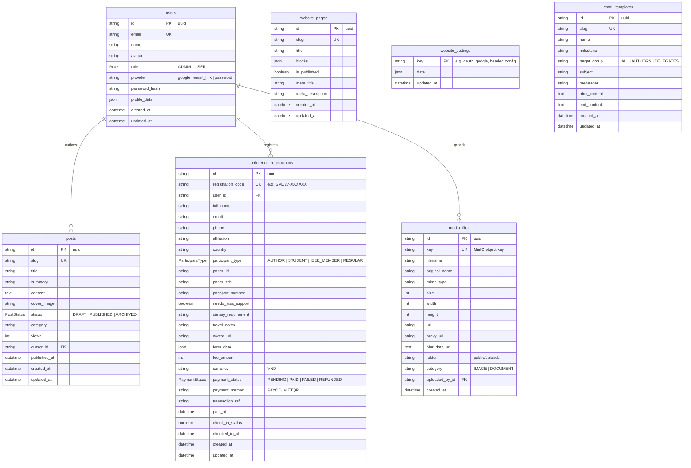

# IEEE SMC 2027 - Database Structure & Management Guide

This document provides a comprehensive specification of the PostgreSQL database schema managed via **Prisma ORM**, table relationships, enum definitions, and instructions for managing user roles.

---

## 1. Entity Relationship Diagram (ERD)



---

## 2. Table Specifications

### 2.1. `users` (Model: `User`)
Stores system users including delegates, authors, reviewers, and platform administrators.

| Column | Type | Constraints / Default | Description |
|---|---|---|---|
| `id` | `String` (UUID) | `@id @default(uuid())` | Primary key |
| `email` | `String` | `@unique` | Normalized lower-case user email address |
| `name` | `String` | Required | Full display name |
| `avatar` | `String` | Optional (`nullable`) | Profile avatar URL |
| `role` | `Role` | `@default(USER)` | System privilege level (`ADMIN` or `USER`) |
| `provider` | `String` | `@default("google")` | Authentication provider (`google`, `email_link`, `password`) |
| `password_hash` | `String` | Optional (`nullable`) | PBKDF2 salt:key hash (for email/password logins) |
| `profile_data` | `Json` | `@default("{}")` | Metadata (affiliation, country, phone, custom attributes) |
| `created_at` | `DateTime` | `@default(now())` | Account creation timestamp |
| `updated_at` | `DateTime` | `@updatedAt` | Last modification timestamp |

**Relations:**
- `posts`: 1-to-many with `posts.author_id` (onDelete: SetNull)
- `registrations`: 1-to-many with `conference_registrations.user_id` (onDelete: SetNull)
- `mediaFiles`: 1-to-many with `media_files.uploaded_by_id` (onDelete: SetNull)

---

### 2.2. `posts` (Model: `Post`)
Stores conference announcements, call for papers, and news articles.

| Column | Type | Constraints / Default | Description |
|---|---|---|---|
| `id` | `String` (UUID) | `@id @default(uuid())` | Primary key |
| `slug` | `String` | `@unique` | URL slug |
| `title` | `String` | Required | Post headline |
| `summary` | `String` | Optional (`nullable`) | Short excerpt preview |
| `content` | `String` (`@db.Text`) | Required | HTML rich text from Tiptap editor |
| `cover_image` | `String` | Optional (`nullable`) | Thumbnail cover URL or MinIO path |
| `status` | `PostStatus` | `@default(DRAFT)` | Publication status (`DRAFT`, `PUBLISHED`, `ARCHIVED`) |
| `category` | `String` | `@default("General")` | Topic category (`Announcements`, `CFP`, `Keynotes`, etc.) |
| `views` | `Int` | `@default(0)` | Read counter |
| `author_id` | `String` | Optional (`nullable`) | Foreign key referencing `users.id` |
| `published_at` | `DateTime` | Optional (`nullable`) | Timestamp of public release |
| `created_at` | `DateTime` | `@default(now())` | Creation timestamp |
| `updated_at` | `DateTime` | `@updatedAt` | Last modification timestamp |

**Indexes:** `@@index([status])`, `@@index([slug])`

---

### 2.3. `conference_registrations` (Model: `Registration`)
Stores delegate tickets, author registrations, payment reconciliation, and check-in statuses.

| Column | Type | Constraints / Default | Description |
|---|---|---|---|
| `id` | `String` (UUID) | `@id @default(uuid())` | Primary key |
| `registration_code` | `String` | `@unique` | Unique human-readable code (e.g. `SMC27-A8B9C0`) |
| `user_id` | `String` | Optional (`nullable`) | Foreign key referencing `users.id` |
| `full_name` | `String` | Required | Delegate full legal name |
| `email` | `String` | Required | Notification & ticket delivery email |
| `phone` | `String` | Optional (`nullable`) | Contact phone number |
| `affiliation` | `String` | Required | University, organization, or corporate sponsor |
| `country` | `String` | Required | Nationality / Country of residence |
| `participant_type` | `ParticipantType`| `@default(REGULAR)` | `AUTHOR`, `STUDENT`, `IEEE_MEMBER`, `REGULAR` |
| `paper_id` | `String` | Optional (`nullable`) | IEEE SMC 2027 paper submission ID |
| `paper_title` | `String` | Optional (`nullable`) | Title of accepted paper |
| `passport_number` | `String` | Optional (`nullable`) | International travel passport number |
| `needs_visa_support` | `Boolean` | `@default(false)` | Requires official conference invitation letter |
| `dietary_requirement`| `String` | `@default("None")` | Halal, Vegetarian, Vegan, Allergies |
| `travel_notes` | `String` | Optional (`nullable`) | Arrival/departure notes |
| `avatar_url` | `String` | Optional (`nullable`) | Badge photo URL stored on MinIO |
| `form_data` | `Json` | `@default("{}")` | Additional survey responses |
| `fee_amount` | `Int` | Required | Registration fee in minor or standard currency units |
| `currency` | `String` | `@default("VND")` | Currency code (`VND`, `USD`) |
| `payment_status` | `PaymentStatus` | `@default(PENDING)` | `PENDING`, `PAID`, `FAILED`, `REFUNDED` |
| `payment_method` | `String` | `@default("PAYOO_VIETQR")` | `PAYOO_VIETQR`, `STRIPE_CARD`, `BANK_TRANSFER` |
| `transaction_ref` | `String` | Optional (`nullable`) | Gateway bank transaction reference |
| `paid_at` | `DateTime` | Optional (`nullable`) | Payment verification timestamp |
| `check_in_status` | `Boolean` | `@default(false)` | On-site registration badge scanned |
| `checked_in_at` | `DateTime` | Optional (`nullable`) | Time delegate arrived at venue |
| `created_at` | `DateTime` | `@default(now())` | Registration submission timestamp |
| `updated_at` | `DateTime` | `@updatedAt` | Last modification timestamp |

**Indexes:** `@@index([registrationCode])`, `@@index([email])`, `@@index([userId])`, `@@index([paymentStatus])`

---

### 2.4. `website_pages` (Model: `Page`)
Dynamic CMS pages with block-based JSON layout.

| Column | Type | Constraints / Default | Description |
|---|---|---|---|
| `id` | `String` (UUID) | `@id @default(uuid())` | Primary key |
| `slug` | `String` | `@unique` | Page route path (e.g. `venue`, `dates`, `committee`) |
| `title` | `String` | Required | Page title |
| `blocks` | `Json` | `@default("[]")` | Modular JSON section components |
| `is_published` | `Boolean` | `@default(true)` | Live status on public portal |
| `meta_title` | `String` | Optional (`nullable`) | SEO Meta title |
| `meta_description` | `String`| Optional (`nullable`) | SEO Meta description |
| `created_at` | `DateTime` | `@default(now())` | Creation timestamp |
| `updated_at` | `DateTime` | `@updatedAt` | Last modification timestamp |

---

### 2.5. `website_settings` (Model: `Setting`)
Key-value JSON configuration store for system credentials, navigation bars, and runtime toggles.

| Column | Type | Constraints / Default | Description |
|---|---|---|---|
| `key` | `String` | `@id` | Primary key (`oauth_google`, `header_config`, etc.) |
| `data` | `Json` | Required | Structured settings payload |
| `updated_at` | `DateTime` | `@updatedAt` | Last modified timestamp |

---

### 2.6. `media_files` (Model: `MediaFile`)
Metadata registry for assets stored in MinIO S3 object storage.

| Column | Type | Constraints / Default | Description |
|---|---|---|---|
| `id` | `String` (UUID) | `@id @default(uuid())` | Primary key |
| `key` | `String` | `@unique` | MinIO object key (`public/uploads/...`) |
| `filename` | `String` | Required | Sanitized storage file name |
| `original_name` | `String` | Required | Original upload filename |
| `mime_type` | `String` | Required | Content MIME type (`image/webp`, `application/pdf`) |
| `size` | `Int` | Required | File size in bytes |
| `width` | `Int` | Optional (`nullable`) | Image pixel width |
| `height` | `Int` | Optional (`nullable`) | Image pixel height |
| `url` | `String` | Required | Direct or signed public S3 URL |
| `proxy_url` | `String` | Required | Internal proxy URL for CDN caching |
| `blur_data_url` | `String` (`@db.Text`) | Optional | Base64 blur preview placeholder |
| `folder` | `String` | `@default("public/uploads")` | Directory namespace |
| `category` | `String` | `@default("IMAGE")` | Asset type (`IMAGE`, `DOCUMENT`, `VIDEO`) |
| `uploaded_by_id`| `String` | Optional (`nullable`) | Foreign key referencing `users.id` |
| `created_at` | `DateTime` | `@default(now())` | Upload timestamp |

**Indexes:** `@@index([category])`, `@@index([folder])`

---

### 2.7. `email_templates` (Model: `EmailTemplate`)
Templates for automated transactional emails and conference announcements.

| Column | Type | Constraints / Default | Description |
|---|---|---|---|
| `id` | `String` (UUID) | `@id @default(uuid())` | Primary key |
| `slug` | `String` | `@unique` | Identifier (`registration_success`, `payment_paid`, etc.) |
| `name` | `String` | Required | Human-friendly title |
| `milestone` | `String` | Required | Trigger point category |
| `target_group` | `String` | `@default("ALL")` | Recipient audience |
| `subject` | `String` | Required | Email subject line with template tags |
| `preheader` | `String` | Optional (`nullable`) | Email client preview snippet |
| `html_content` | `String` (`@db.Text`) | Required | Responsive HTML email body |
| `text_content` | `String` (`@db.Text`) | Required | Plaintext fallback |
| `created_at` | `DateTime` | `@default(now())` | Creation timestamp |
| `updated_at` | `DateTime` | `@updatedAt` | Last modification timestamp |

---

## 3. Enums Definition

```prisma
enum Role {
  ADMIN
  USER
}

enum PostStatus {
  DRAFT
  PUBLISHED
  ARCHIVED
}

enum PaymentStatus {
  PENDING
  PAID
  FAILED
  REFUNDED
}

enum ParticipantType {
  AUTHOR
  STUDENT
  IEEE_MEMBER
  REGULAR
}
```

---

## 4. How to Manage User Roles

User privileges in IEEE SMC 2027 are determined by the `role` column in the `users` table:
- **`ADMIN`**: Full access to the Admin Dashboard (`/admin`), CMS, registrations, check-in, media files, and system settings.
- **`USER`**: Standard attendee/author access limited to the attendee portal (`/portal`), paper registrations, and personal profile.

You can manage user roles through any of the following 4 methods:

### Method 1: Admin Dashboard UI (Recommended)
1. Log into `/admin` as an administrator.
2. Navigate to **Users** in the sidebar menu or open [`/admin/users`](http://localhost:3000/admin/users).
3. In the user list table:
   - Click the **Edit** icon on any user row.
   - Change the **Role** field between `ADMIN` and `USER`.
   - Click **Save Changes**.
4. To create a new user with a specific role, click **+ Add User** in the top right, fill in credentials, select `ADMIN` or `USER`, and submit.

### Method 2: Prisma Studio (Visual Web Database Interface)
Run the built-in Prisma Studio tool:
```bash
pnpm db:studio
# Or: npx prisma studio
```
1. Open [`http://localhost:5555`](http://localhost:5555) in your browser.
2. Select the **`User`** model.
3. Locate the target user and click on the **`role`** dropdown column.
4. Select `ADMIN` or `USER`, then click **Save changes**.

### Method 3: Direct SQL Command
Execute directly on your PostgreSQL database (via psql, Neon console, pgAdmin, or DBeaver):
```sql
-- Promote user to ADMIN
UPDATE users 
SET role = 'ADMIN', updated_at = NOW() 
WHERE email = 'tctoan1024@gmail.com';

-- Demote user to standard USER
UPDATE users 
SET role = 'USER', updated_at = NOW() 
WHERE email = 'user@example.com';

-- List all current system administrators
SELECT id, email, name, role, provider, created_at 
FROM users 
WHERE role = 'ADMIN';
```

### Method 4: Database Seed Script
To preconfigure initial administrator accounts, update [`prisma/seed.ts`](file:///Users/macos/ieee-smc-2027/prisma/seed.ts) and run:
```bash
npx ts-node prisma/seed.ts
# or: node -e 'require("ts-node/register"); require("./prisma/seed.ts");'
```

---

## 5. Prisma CLI Commands Cheatsheet

| Command | Action |
|---|---|
| `pnpm db:generate` | Regenerates `@prisma/client` TypeScript types after schema edits |
| `pnpm db:push` | Synchronizes `schema.prisma` directly to database without creating migration files |
| `pnpm db:migrate` | Applies pending migration files to the target database |
| `pnpm db:studio` | Launches interactive browser GUI for browsing and editing tables |
