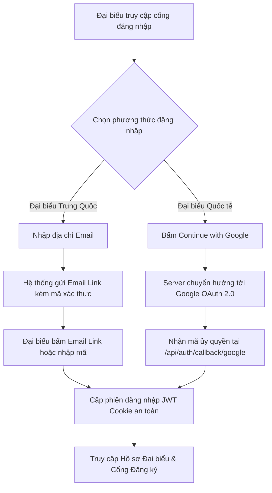
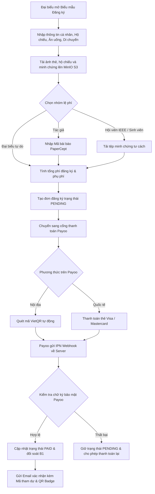
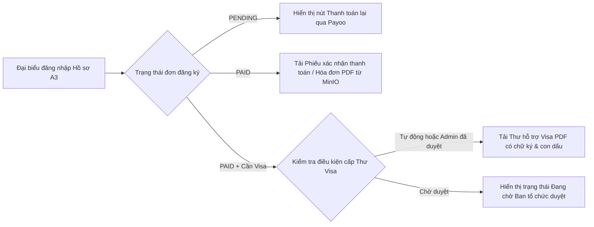
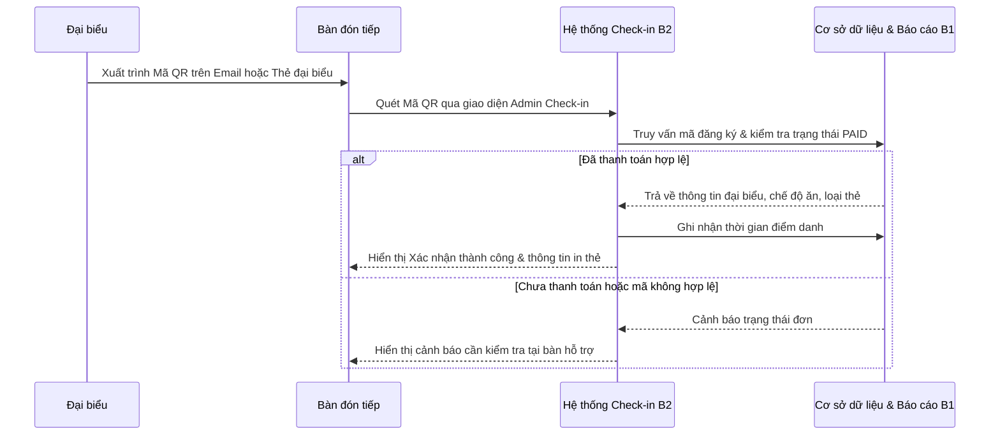

# Đặc Tả Kỹ Thuật, Sơ Đồ Luồng Hệ Thống & Danh Sách Câu Hỏi Làm Rõ Dữ Liệu

Tài liệu này tổng hợp bảng đặc tả chức năng của hệ thống Website **IEEE SMC 2027**, sơ đồ luồng nghiệp vụ cho đội phát triển, các quyết định kỹ thuật đã chốt và danh sách câu hỏi cần làm rõ thêm với Ban tổ chức.

---

## 1. Tổng Hợp Các Quyết Định Kỹ Thuật Đã Chốt Cho Đội Phát Triển

| Phân hệ | Hạng mục | Quyết định đã chốt | Việc cần thực hiện cho đội kỹ thuật |
| :--- | :--- | :--- | :--- |
| **A1** | Phương thức đăng nhập | Đại biểu Trung Quốc dùng **Email Link / OTP**, đại biểu quốc tế dùng **Google OAuth** | Giữ luồng xác thực kép trên trang đăng nhập; không tải script Google trực tiếp ở trình duyệt khi chưa bấm nút đăng nhập |
| **A1** | Bản đồ & Video | Sử dụng **QQ Video** — Đã nghiên cứu | Thay thế trình phát YouTube bằng nhúng QQ Video hoặc luồng phát tương thích tại Trung Quốc |
| **A1** | Ngôn ngữ hiển thị | **Tiếng Anh** | Chuẩn hóa toàn bộ giao diện đại biểu và thông báo hệ thống sang tiếng Anh |
| **A2** | Cổng thanh toán | **Payoo** | Thay thế cấu hình cổng thanh toán tạm bằng tích hợp Payoo cho cả VietQR và thẻ quốc tế Visa/Mastercard |
| **A4** | Cổng nộp bài | **PaperCept** | Cập nhật toàn bộ liên kết nộp bài và trường mã bài báo theo chuẩn PaperCept |
| **B3** | Hạ tầng Máy chủ | **Toản phụ trách trả lời & cấu hình** | Chốt phương án máy chủ, băng thông quốc tế đi Trung Quốc và mở tường lửa nhận tín hiệu Webhook từ Payoo |
| **B3** | Tên miền | **ieee-smc-2027** | Cấu hình tên miền chính thức và chứng chỉ SSL khi triển khai thực tế |

---

## 2. Sơ Đồ Luồng Nghiệp Vụ Hệ Thống

### 2.1. Luồng A1: Xác Thực Đại Biểu Quốc Tế & Đại Biểu Trung Quốc

---

### 2.2. Luồng A2, A4 & B1: Đăng Ký Tham Dự, Đối Chiếu PaperCept & Thanh Toán Payoo

---

### 2.3. Luồng A3: Hồ Sơ Cá Nhân, Xuất Phiếu Thu & Thư Hỗ Trợ Visa

---

### 2.4. Luồng B2: Quét Mã QR Điểm Danh Tại Hội Trường & Xuất Báo Cáo

---

## 3. Bảng Đặc Tả Chức Năng Hệ Thống

### Phân hệ A: Giao diện Đại biểu & Cổng thông tin
1. **A1 - Giao diện Website & Quản trị Nội dung CMS:**
   - Bàn giao khung giao diện để Ban tổ chức chủ động cập nhật chương trình, mốc thời gian, tin tức và diễn giả.
   - Thiết kế chuẩn nhận diện IEEE SMC 2027, sử dụng hoàn toàn **Tiếng Anh**.
   - Tối ưu riêng cho đại biểu Trung Quốc: sử dụng **Email Link / OTP** cho đại biểu Trung Quốc và **Google OAuth** cho đại biểu quốc tế; sử dụng **QQ Video** cho nội dung video.
2. **A2 - Cổng Đăng ký & Tích hợp Thanh toán Payoo:**
   - Biểu mẫu thu thập dữ liệu đại biểu: Họ tên, Đơn vị, Ảnh, Hộ chiếu, Visa, Ăn uống, Di chuyển.
   - Phân loại lệ phí: Tác giả, Sinh viên, Hội viên IEEE, Đại biểu tự do.
   - Tích hợp cổng thanh toán **Payoo**: hỗ trợ quét mã QR chuyển khoản tự động VietQR và thẻ quốc tế Visa/Mastercard.
   - Tự động gửi email xác nhận đăng ký kèm mã tham dự.
3. **A3 - Trang Hồ sơ Cá nhân Đại biểu:**
   - Đại biểu đăng nhập xem lịch sử đăng ký, mã số tham dự và trạng thái thanh toán cá nhân.
   - Tải trực tiếp Phiếu thu / Hóa đơn điện tử và Thư hỗ trợ Visa được lưu trữ trên MinIO.
4. **A4 - Liên kết Cổng nộp bài PaperCept & Lịch trình Báo cáo:**
   - Tích hợp liên kết cổng nộp bài **PaperCept** và đối chiếu mã bài báo.
   - Hiển thị lịch trình các phiên báo cáo song song cho đại biểu dễ theo dõi.

### Phân hệ B: Quản trị, Đối soát, Điểm danh & Hạ tầng
1. **B1 - Trang Quản trị Admin & Đối soát Thanh toán Payoo:**
   - Quản lý danh sách đăng ký và theo dõi trạng thái thanh toán theo thời gian thực.
   - Tự động đối soát giao dịch qua IPN Webhook từ **Payoo**.
   - Tự động xuất báo cáo danh sách đại biểu và tài chính.
2. **B2 - Mã QR Điểm danh & Gửi Email Hàng loạt:**
   - Tự động sinh mã QR trên Thẻ đại biểu phục vụ quét điểm danh tại hội trường.
   - Hệ thống gửi email hàng loạt nhắc lịch nộp bài, thư mời và thông báo khẩn từ Ban tổ chức.
3. **B3 - Hạ tầng Máy chủ, Lưu trữ MinIO & Tên miền:**
   - Triển khai qua Docker Compose do **Toản** phụ trách cấu hình mạng và máy chủ.
   - Lưu trữ tệp tập trung trên MinIO S3.
   - Cấu hình bảo mật SSL cho tên miền **ieee-smc-2027**.

---

## 4. Danh Sách Câu Hỏi & Trạng Thái Làm Rõ Với Ban Tổ Chức

### A1. Giao diện, CMS & Tối ưu cho đại biểu Trung Quốc
- **Phương thức đăng nhập:** Khi loại bỏ dịch vụ Google, đại biểu sẽ đăng nhập bằng Email nhận mã OTP, mật khẩu hay thêm đăng nhập WeChat?
  - **Đã chốt:** Với đại biểu Trung Quốc sử dụng **Email Link / OTP**, đối với đại biểu khác thì dùng **Google OAuth**.
- **Dịch vụ thay thế:** Bản đồ chỉ đường và video trên web sẽ dùng nền tảng nào để không bị chặn tại Trung Quốc?
  - **Đã chốt:** Sử dụng **QQ Video** — Đã nghiên cứu.
- **Ngôn ngữ:** Website chỉ dùng tiếng Anh hay cần đa ngôn ngữ?
  - **Đã chốt:** Chỉ sử dụng **Tiếng Anh**.

### A2. Cổng Đăng ký & Thanh toán Ngân hàng
- **Cổng thanh toán:** Sử dụng đơn vị trung gian nào cho VietQR tự động và cổng nào cho thẻ quốc tế Visa/Mastercard?
  - **Đã chốt:** Sử dụng **Payoo**.
- **Dữ liệu Hộ chiếu & Visa:** Chỉ nhập thông tin dạng chữ và ngày tháng như Số hộ chiếu, Ngày cấp, Ngày hết hạn, Quốc tịch hay bắt buộc tải lên ảnh chụp hộ chiếu? Giới hạn định dạng và dung lượng tệp là bao nhiêu?
  - **Trạng thái:** Cần Ban tổ chức chốt.
- **Dữ liệu Ăn uống & Di chuyển:**
  - **Ăn uống:** Chọn từ danh sách cố định như Bình thường, Chay, Halal, Dị ứng hay nhập tự do?
  - **Di chuyển:** Cần thu thập những trường nào: Số hiệu chuyến bay, Ngày giờ đến và đi, Nơi lưu trú, Nhu cầu xe đưa đón?
  - **Trạng thái:** Cần Ban tổ chức chốt.
- **Ảnh thẻ đại biểu:** Có bắt buộc tải lên khi đăng ký không và yêu cầu tỷ lệ khung hình, độ phân giải tối thiểu như thế nào?
  - **Trạng thái:** Cần Ban tổ chức chốt.
- **Bảng giá & Tiền tệ:** Mức phí cụ thể cho từng nhóm đối tượng theo giai đoạn đăng ký sớm/muộn là bao nhiêu? Thu bằng VND, USD hay cả hai?
  - **Trạng thái:** Cần Ban tổ chức chốt.
- **Xác minh đối tượng & Phụ phí:**
  - Kiểm tra tư cách Hội viên IEEE, Sinh viên, Tác giả bằng cách tải minh chứng để duyệt thủ công hay kiểm tra tự động?
  - Cách tính phụ phí khi tác giả đăng ký nhiều bài báo, vượt số trang quy định hoặc mua thêm vé tiệc tối như thế nào?
  - **Trạng thái:** Cần Ban tổ chức chốt.

### A3. Hồ sơ Cá nhân, Hóa đơn & Thư hỗ trợ Visa
- **Phiếu thu & Hóa đơn:** Hệ thống chỉ xuất Phiếu xác nhận thanh toán PDF theo mẫu của hội nghị hay phải tích hợp xuất Hóa đơn điện tử có mã cơ quan thuế? Có cần thêm trường Mã số thuế, Tên đơn vị, Địa chỉ trên form đăng ký không?
  - **Trạng thái:** Cần Ban tổ chức chốt.
- **Thư hỗ trợ Visa:** Điều kiện để đại biểu tải thư là gì: chỉ cần thanh toán xong hay phải được Admin duyệt? Ban tổ chức đã có mẫu file kèm chữ ký/con dấu và danh sách các trường dữ liệu cần điền tự động chưa?
  - **Trạng thái:** Cần Ban tổ chức chốt.

### A4. Cổng nộp bài & Lịch trình Báo cáo
- **Đồng bộ bài báo:** Chốt dùng PaperCept, EDAS hay hệ thống nào? Chỉ gắn link chuyển hướng hay cần nhập danh sách Mã bài báo được chấp nhận vào hệ thống để kiểm tra khi tác giả đóng phí?
  - **Đã chốt cổng:** **PaperCept**. Cần làm rõ thêm việc nhập danh sách Mã bài báo được chấp nhận để kiểm tra tự động khi đóng phí.
- **Dữ liệu Lịch trình báo cáo:** Cấu trúc dữ liệu lịch trình gồm Ngày, Giờ, Phòng, Tên phiên, Chủ tọa, Mã bài, Tên bài, Tác giả sẽ được nhập lên hệ thống bằng file Excel/CSV hay nhập tay trên CMS?
  - **Trạng thái:** Cần Ban tổ chức chốt.

### B1. Quản trị Admin & Đối soát Thanh toán
- **Đối soát tự động:** Tài khoản nhận tiền thuộc ngân hàng nào, đứng tên cá nhân hay tổ chức để chọn giải pháp kết nối biến động số dư tự động qua Payoo?
  - **Trạng thái:** Cần Ban tổ chức cung cấp thông tin Merchant Payoo.
- **Mẫu báo cáo:** Ban tổ chức có biểu mẫu Excel/PDF chuẩn với các cột dữ liệu bắt buộc để phục vụ báo cáo tài chính cho nhà trường và IEEE không?
  - **Trạng thái:** Cần Ban tổ chức chốt.

### B2. Mã QR Điểm danh & Gửi Email Hàng loạt
- **Luồng quét QR Check-in:** Quét bằng camera điện thoại/máy tính bảng trên giao diện web hay dùng đầu đọc mã vạch chuyên dụng? Điểm danh 1 lần cho cả kỳ hội nghị hay điểm danh riêng theo từng ngày, từng phiên và buổi tiệc?
  - **Trạng thái:** Cần Ban tổ chức chốt.
- **Gửi Email hàng loạt:** Ban tổ chức có chốt làm tính năng này không? Dự kiến số lượng thư gửi mỗi đợt là bao nhiêu và đã có dịch vụ gửi email tên miền riêng chưa?
  - **Trạng thái:** Cần Ban tổ chức chốt.

### B3. Hạ tầng Máy chủ & Tên miền
- **Máy chủ triển khai:** Đặt tại máy chủ nhà trường hay thuê đám mây ngoài? Nếu đặt tại trường thì băng thông quốc tế đi Trung Quốc và việc mở cổng nhận tín hiệu thanh toán từ ngân hàng có bị tường lửa nội bộ chặn không?
  - **Phụ trách:** **Toản trả lời**.
- **Tên miền:** Tên miền chính thức của hội nghị là gì và đơn vị nào đang quản trị cấu hình DNS?
  - **Đã ghi nhận:** **ieee-smc-2027**. Cần xác nhận đuôi tên miền chính thức và quyền trỏ DNS.
